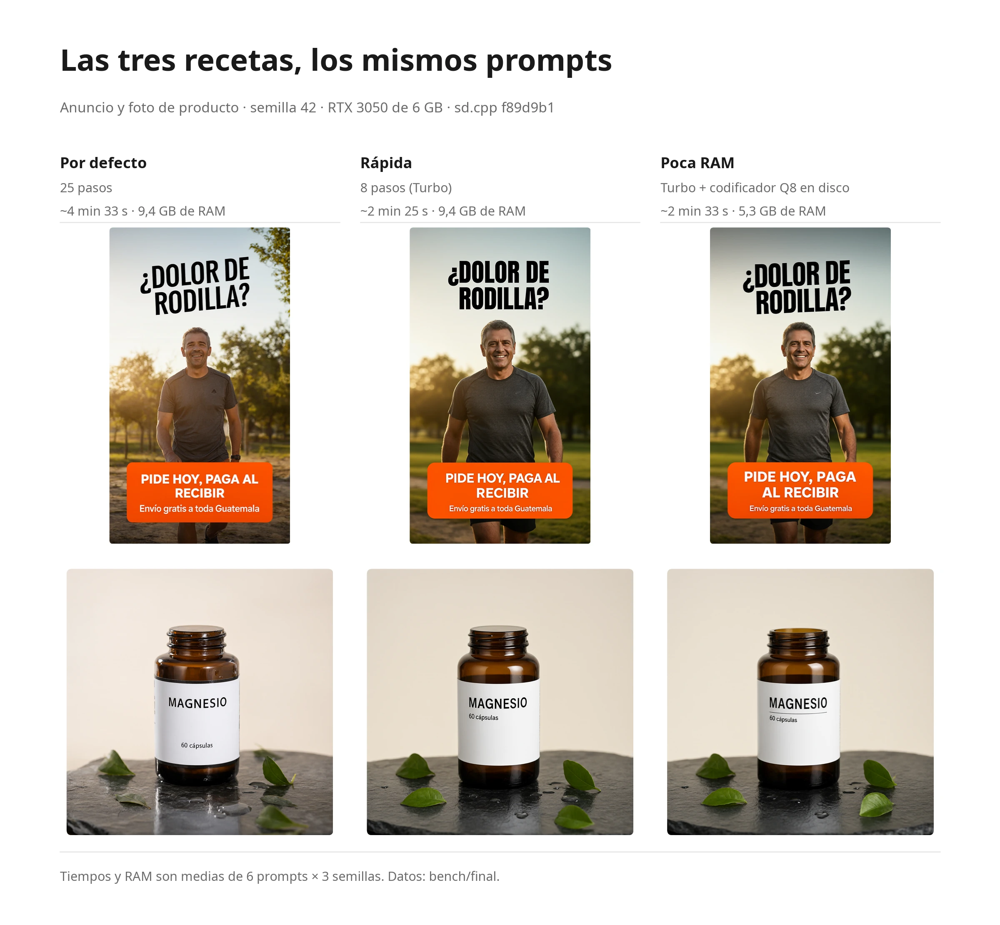
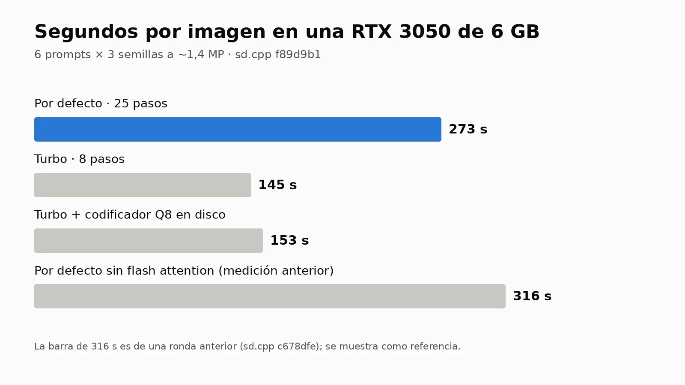
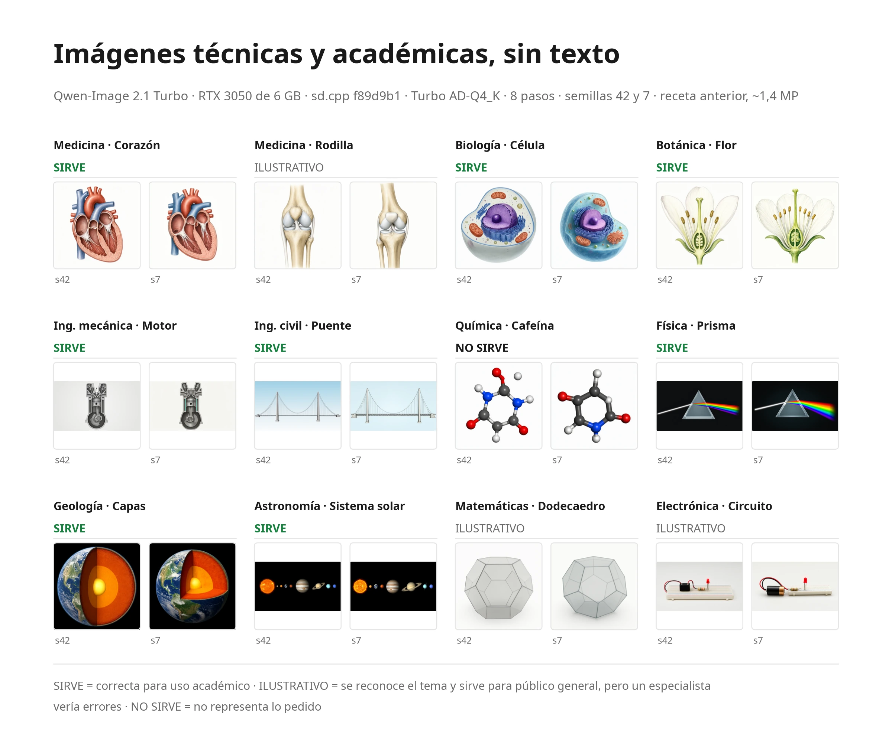

# Qwen-Image 2.1 Turbo en una GPU de 6 GB

Receta medida para ejecutar [Qwen-Image 2.1 Turbo](https://huggingface.co/Qwen/Qwen-Image-2.1-Turbo) en local en una **RTX 3050 con 6 GB de VRAM y 16 GB de RAM**, con [stable-diffusion.cpp](https://github.com/leejet/stable-diffusion.cpp). Sin ComfyUI y sin entorno de Python: un binario compilado y tres o cuatro ficheros de modelo.

Turbo es el checkpoint oficial `Qwen/Qwen-Image-2.1-Turbo`: la misma arquitectura de 7B que Qwen-Image 2.1, destilada a 8 pasos con CFG 1 y con su propio calendario de ruido. Usa el mismo VAE y el mismo codificador de texto que Qwen-Image 2.1. Tarda aproximadamente la mitad que el modelo normal. Si te importa más la calidad que la velocidad, usa la [receta normal](../Qwen-Image-2.1/README.es.md).

La receta tiene dos variantes: **Rápida** (unos 2 min 25 s por imagen) y **Poca RAM** (casi la velocidad de la rápida con 5,3 GB de RAM en lugar de 9,4 GB).

Todos los números de esta página se midieron en esa máquina. Los scripts que los generaron están en [`scripts/`](scripts/) y los resultados en bruto, un CSV por ronda, en [`bench/`](bench/).

[English version](README.md)

> [!IMPORTANT]
> **Los pesos del modelo solo se pueden usar con fines no comerciales.** El checkpoint Turbo está bajo la [Qwen Research License](https://huggingface.co/Qwen/Qwen-Image-2.1/blob/main/LICENSE) (sección 2), las mismas condiciones que Qwen-Image 2.1: se permiten la investigación y la evaluación. El uso comercial, incluidos anuncios o fotos de producto para un negocio, requiere una licencia aparte de Qwen (`model-business@notice.qwencloud.com`). Esta guía explica cómo ejecutar el modelo, no qué puedes hacer con lo que genera.

## La receta

### Rápida

```bash
sd-cli \
  --diffusion-model Qwen-Image-2.1-Turbo-AD-Q4_K.gguf \
  --vae qwen_image_2.1_vae_bf16.safetensors \
  --llm Qwen3VL-8B-Instruct-Q4_K_M.gguf \
  --offload-to-cpu --diffusion-fa \
  --vae-tiling \
  --cfg-scale 1 --sampling-method euler --steps 8 \
  --sigmas "1.0,0.978453,0.95418,0.926626,0.89508,0.845148,0.704534,0.414568,0.0" \
  -W 1184 -H 1184 \
  -p "tu prompt" -o salida.png
```

**`--sigmas` es obligatorio.** Sin él, el modelo Turbo produce texto roto (ver [Ajustar el modelo Turbo](#ajustar-el-modelo-turbo)). Los nueve valores son el calendario de 8 pasos del propio checkpoint más el 0 final.

### Poca RAM

Igual que la rápida, pero con el codificador de texto Q8_0, más grande, leído del disco en lugar de mantenerlo en RAM:

```bash
sd-cli \
  --diffusion-model Qwen-Image-2.1-Turbo-AD-Q4_K.gguf \
  --vae qwen_image_2.1_vae_bf16.safetensors \
  --llm Qwen3VL-8B-Instruct-Q8_0.gguf \
  --params-backend "te=disk,diffusion=cpu,vae=cpu" \
  --offload-to-cpu --diffusion-fa \
  --vae-tiling \
  --cfg-scale 1 --sampling-method euler --steps 8 \
  --sigmas "1.0,0.978453,0.95418,0.926626,0.89508,0.845148,0.704534,0.414568,0.0" \
  -W 1184 -H 1184 \
  -p "tu prompt" -o salida.png
```

El codificador de texto se usa una sola vez por imagen, así que leer sus pesos del disco cuesta poco.

| | Rápida | Poca RAM |
|---|---|---|
| Para qué | Imágenes del día a día en aproximadamente la mitad de tiempo que la receta normal | Máquinas donde 9,4 GB de RAM libre son demasiados |
| Modelo de difusión | Turbo AD-Q4_K | Turbo AD-Q4_K |
| Codificador de texto | Q4_K_M | Q8_0, leído del disco |
| Pasos | 8 | 8 |
| Cuadrada | 1184 × 1184 | 1184 × 1184 |
| Vertical 9:16 | 896 × 1568 | 896 × 1568 |
| Horizontal 16:9 | 1568 × 896 | 1568 × 896 |
| Tiempo por imagen | **~2 min 25 s** (media 145,2 s, rango 139,5-147,5) | **~2 min 33 s** (media 152,6 s, rango 147,2-164,1) |
| RAM máxima del sistema | 9,4 GB | **5,3 GB** |

Las dos usan flash attention y CFG 1. El tiempo es de reloj e incluye toda la ejecución: carga, codificación del texto, muestreo y decodificación del VAE. Las medidas tienen que ser múltiplos de 32.

Poca RAM no se volvió más lenta en 18 imágenes seguidas. Se midió con los servicios de la máquina parados. Con mucha RAM ocupada por otros programas, el sistema podría tener que releer el codificador del disco en cada imagen; eso no se ha medido.

## Instalación

### 1. Compilar stable-diffusion.cpp con CUDA

Usa [`c150a6b`](https://github.com/leejet/stable-diffusion.cpp/commit/c150a6b) (2026-10-06) o posterior. Arregló los calendarios de ruido a medida (`--sigmas`), que el modelo Turbo necesita. La ronda final se midió con `f89d9b1` (2026-10-09).

```bash
git clone --recursive https://github.com/leejet/stable-diffusion.cpp
cd stable-diffusion.cpp
cmake -B build -G Ninja -DSD_CUDA=ON -DCMAKE_CUDA_ARCHITECTURES=86 -DCMAKE_BUILD_TYPE=Release
cmake --build build -j
# binarios: build/bin/sd-cli y build/bin/sd-server
```

`86` es la arquitectura de la serie RTX 30. Usa `89` para las RTX 40, o quita la opción para que CMake la detecte.

### 2. Descargar los ficheros del modelo

La rápida necesita tres ficheros; Poca RAM cambia el codificador de texto por el Q8_0.

| Pieza | Fichero | Tamaño | SHA-256 | Lo usan |
|---|---|---|---|---|
| Modelo de difusión | [`Qwen-Image-2.1-Turbo-AD-Q4_K.gguf`](https://huggingface.co/AtomicChat/Qwen-Image-2.1-Turbo-GGUF) (AtomicChat) | 4,20 GB | `4bb73c53…8130bc59` | Rápida, Poca RAM |
| Codificador de texto | [`Qwen3VL-8B-Instruct-Q4_K_M.gguf`](https://huggingface.co/Qwen/Qwen3-VL-8B-Instruct-GGUF/blob/main/Qwen3VL-8B-Instruct-Q4_K_M.gguf) (Qwen) | 5,0 GB | `67d1659b…0e9e2` | Rápida |
| Codificador de texto | [`Qwen3VL-8B-Instruct-Q8_0.gguf`](https://huggingface.co/Qwen/Qwen3-VL-8B-Instruct-GGUF/blob/main/Qwen3VL-8B-Instruct-Q8_0.gguf) (Qwen) | 8,71 GB | `0d264b39…5844adb0` | Solo Poca RAM |
| VAE | [`qwen_image_2.1_vae_bf16.safetensors`](https://huggingface.co/Comfy-Org/Qwen-Image-2.1/blob/main/vae/qwen_image_2.1_vae_bf16.safetensors) (Comfy-Org) | 0,68 GB | `bb21f747…e4876b7c9` | Ambas |

Los hashes completos están en [`SHA256SUMS`](SHA256SUMS). El VAE es exclusivo de la 2.1: los de Qwen-Image 1 y Wan 2.2 no sirven.

**Por qué los ficheros Turbo de AtomicChat.** El modelo Turbo es una cuantización del checkpoint oficial [Qwen/Qwen-Image-2.1-Turbo](https://huggingface.co/Qwen/Qwen-Image-2.1-Turbo). Elegimos los [ficheros GGUF de AtomicChat](https://huggingface.co/AtomicChat/Qwen-Image-2.1-Turbo-GGUF) porque midieron la fidelidad de cada cuantización frente al original en BF16 (LPIPS; AD-Q4_K obtiene 0,147) y publicaron sus renders, y porque comprobaron que un codificador de texto Q8_0 se desvía menos que un Q4_K_M. Verificamos su SHA-256 y la estructura de los ficheros: capas de modulación en Q8_0; timestep, norma final y proyección de salida en BF16.

### 3. Liberar la GPU

La receta usa la tarjeta entera. Cierra cualquier otro programa que ocupe VRAM (un servidor de LLM, Whisper) antes de generar, o la ejecución fallará por falta de memoria.

## Ajustar el modelo Turbo

Medido con los prompts de anuncio y producto, semilla 42, en `f89d9b1`. Datos en bruto: [`bench/turbo1/`](bench/turbo1/). Script: [`scripts/turbo1.sh`](scripts/turbo1.sh).

| Cambio | Resultado |
|---|---|
| **AD-Q4_K a 1,4 MP (la receta rápida)** | **140 s** |
| AD-Q5_K | 152-154 s y 10,5 GB de RAM, sin mejora visible |
| 1 MP | 122 s, pero deformó "MAGNESIO" |
| 2,4 MP | 215 s |
| **Sin `--sigmas`** | Cuesta lo mismo, pero el titular del anuncio sale roto (letras duplicadas, corchetes). **El calendario propio es obligatorio.** |
| Codificador Q8_0 en RAM | 152-172 s y 12,6 GB de RAM; solo cabe con la máquina casi vacía |
| Codificador Q8_0 en disco (Poca RAM) | Imagen idéntica bit a bit a la de RAM |

## Comparativa con la receta normal

Las tres recetas (normal, rápida y poca RAM), 6 prompts × 3 semillas cada una: 54 imágenes, con sd.cpp `f89d9b1` (ronda final). Datos en bruto en [`bench/final/`](bench/final/); votos y clave en [`bench/final/ciego/`](bench/final/ciego/). Script: [`scripts/final.sh`](scripts/final.sh).

| | Normal ([receta](../Qwen-Image-2.1/README.es.md)) | **Rápida** | **Poca RAM** |
|---|---|---|---|
| Preferencia a ciegas (18 comparaciones) | **9** | 3 | 3 (+3 empates) |
| Imágenes con el texto perfecto (9 con texto) | 6 / 9 | 6 / 9 | 6 / 9 |
| Imágenes con la mancha blanca | 0 / 18 | 0 / 18 | 0 / 18 |
| Tiempo por imagen | 4 min 33 s | 2 min 25 s | 2 min 33 s |
| RAM máxima del sistema | 9,4 GB | 9,4 GB | 5,3 GB |


*Los mismos prompts de anuncio y producto con las tres recetas.*



Cuánto fiarse de cada resultado:

- **Preferencia a ciegas.** Las imágenes se mostraron al mismo tamaño y en orden aleatorio, y votó una sola persona. La receta normal ganó las 3 comparaciones de producto y las 3 de ciudad; Poca RAM ganó 2 de los 3 anuncios. Por azar, cada receta sacaría unas 5 de las 18. La ventaja de la receta normal es una señal clara, pero no una prueba, porque hubo un solo votante.
- **Texto.** Las 9 imágenes con texto de cada receta son el anuncio, el producto y la ilustración médica (3 semillas cada uno). Las tres recetas acertaron 6 de 9, con fallos distintos:
  - La receta normal falló un anuncio ("Envio" sin tilde) y dos imágenes médicas (una etiqueta "Tibia" repetida y "Tibla").
  - La rápida y la de poca RAM acertaron los 6 anuncios y productos y fallaron las 3 imágenes médicas (la tilde de "Rótula" deforme, "Cartílago" repetida, "Tiobia").

  El texto se revisó letra por letra, a ojo, no con OCR. La ilustración médica, con muchas etiquetas pequeñas, es el caso más difícil para todas las recetas.
- **Manchas blancas.** 0 de 54 imágenes, con sd.cpp `0a9340c` o posterior.

En conjunto: la receta normal es la que conviene cuando importa más la calidad. La rápida y la de poca RAM pierden preferencia en la prueba a ciegas. En texto empatan en total (6 de 9 cada una), pero fallan en sitios distintos: acertaron los 6 anuncios y fotos de producto, donde la receta normal se dejó una tilde, y fallaron las 3 ilustraciones médicas con etiquetas, donde la receta normal acertó una.

## Para qué sirve

Prompts probados: fotos de producto, retratos, anuncios con texto en español, concept art, ilustración anime y escenas de ciudad. El texto es el punto fuerte del modelo en anuncios y etiquetas de producto, tildes incluidas, pero las listas largas de etiquetas pequeñas (la ilustración médica) siguen fallando en todas las recetas.

**Imágenes técnicas y académicas.** Probamos 12 temas de distintas disciplinas, sin texto en la imagen, 2 semillas cada uno, con la receta rápida. Datos en bruto: [`bench/tecnico-turbo/`](bench/tecnico-turbo/).



- **Sirven (8):** corazón, célula, flor, motor, puente colgante, prisma, capas de la Tierra y sistema solar. El motor ahora dibuja un solo cilindro, como pide el prompt.
- **Ilustrativas (3):** rodilla (la rótula sigue mal colocada), dodecaedro (algunas caras parecen hexágonos) y circuito. Se reconocen y valen para público general, pero un especialista vería errores.
- **No sirve (1):** cafeína. No es la molécula pedida.

Con el modelo normal a 15 pasos (ronda anterior), el reparto fue 7 / 4 / 1, y el motor solo era ilustrativo.

En resumen: sirve para figuras de libro de texto de estructuras grandes y conocidas. No es fiable cuando los detalles tienen que ser exactos: moléculas concretas, piezas mecánicas precisas o la relación espacial entre partes. **Genera sin etiquetas y ponlas tú:** cuando se le piden, el modelo las escribe bien pero las coloca apuntando a la parte equivocada.

## Un resultado que no sabemos explicar

Poca RAM muestrea más rápido por paso que la rápida (9,2 frente a 11,1 s/paso), aunque en total tarda algo más por la lectura del codificador. No hemos demostrado la causa. Colocar los pesos a mano con `--params-backend` manteniendo el codificador en RAM no dio una mejora consistente.

## Otras cosas que conviene saber

- **Mantén `--vae-tiling`.** Decodificar una imagen de 1 MP de una vez necesita más de 6 GB, y sd.cpp acaba recurriendo a los trozos igualmente. Los trozos de 256 px por defecto funcionan bien. Desde [`19bbbca`](https://github.com/leejet/stable-diffusion.cpp/commit/19bbbca1), `--vae-tile-size` se mide en píxeles de la imagen, no en celdas del latente. **Nunca decodifiques en CPU sin trozos:** a 1024² agotó los 16 GB de RAM y el kernel mató el proceso.
- **La primera imagen tras reiniciar tarda ~1 minuto más** si los pesos están en un disco duro mecánico, porque hay que leer ~10 GB. Después quedan en la caché del sistema y cargan en ~3 s.
- **No midas mientras descargas.** Las descargas al mismo disco expulsan los pesos de la caché; en nuestras pruebas la carga pasó de 3 s a 36 s.
- **La columna de VRAM siempre marca ~5,1-5,2 GB.** sd.cpp ocupa toda la memoria libre y trae el resto desde la RAM. Es lo que usa, no lo que necesita; la VRAM mínima no se ha medido.
- **Los PNG de salida son RGBA** aunque la imagen sea opaca, porque Qwen-Image 2.1 admite transparencia.

## Reproducir las medidas

```bash
scripts/bench.sh <ronda> <nombre> <modelo> <pasos> <prompt_id> [W H] [-- opciones extra de sd-cli]
scripts/turbo1.sh     # configuración del Turbo: cuantización, resolución, calendario, codificador
scripts/final.sh      # comparativa final y prueba técnica del Turbo (reanudable)
```

`bench.sh` acepta el sufijo de un fichero de modelo o la ruta completa de un `.gguf` (como el del Turbo). La variable de entorno `LLM` elige el codificador de texto; por defecto es el Q4_K_M.

Los prompts están en [`prompts/`](prompts/). Cada ejecución añade una fila a un `resultados.csv` con el tiempo, la RAM y la VRAM máximas y las opciones exactas; las imágenes y los logs se guardan al lado, pero no se incluyen en este repo. Datos por ronda: [`bench/turbo1/`](bench/turbo1/) (configuración del Turbo), [`bench/final/`](bench/final/) (comparativa final, con los votos de la prueba a ciegas y su clave en [`bench/final/ciego/`](bench/final/ciego/)) y [`bench/tecnico-turbo/`](bench/tecnico-turbo/) (prueba técnica con el Turbo). Los scripts usan las rutas de la máquina de pruebas; cambia `D` y `SD` al principio de `bench.sh`.

## Máquina de pruebas

| | |
|---|---|
| GPU | NVIDIA RTX 3050 6 GB (5,8 GiB utilizables), driver 595.71.05, CUDA 13.0 |
| CPU / RAM | 6 núcleos, 16 GB |
| Almacenamiento | Pesos en un disco duro de 7200 rpm |
| Sistema | Ubuntu 24.04 |
| sd.cpp | `f89d9b1` (2026-10-09) en todas las pruebas de esta página |

## Licencia

Los scripts de esta carpeta se publican con la [licencia MIT](../LICENSE). Los pesos del modelo no se incluyen y mantienen sus propias licencias: el checkpoint Turbo y el VAE, la [Qwen Research License](https://huggingface.co/Qwen/Qwen-Image-2.1/blob/main/LICENSE) (no comercial); el codificador de texto Qwen3-VL, Apache 2.0.
