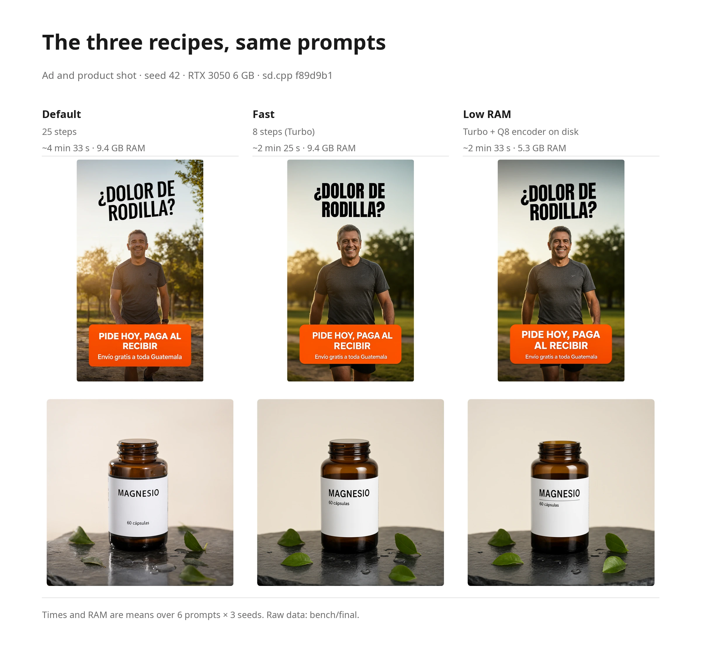
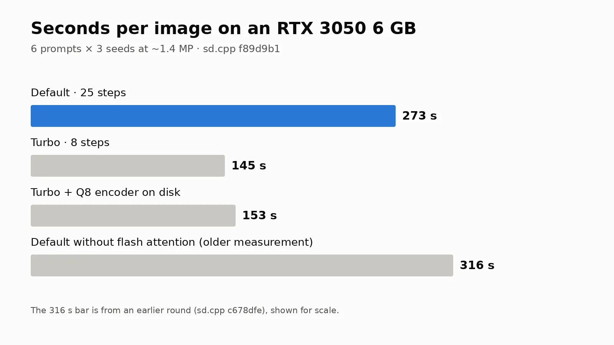
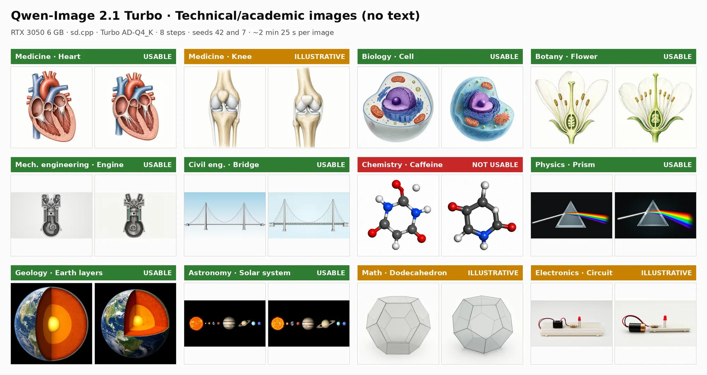

# Qwen-Image 2.1 Turbo on a 6 GB GPU

A measured recipe for running [Qwen-Image 2.1 Turbo](https://huggingface.co/Qwen/Qwen-Image-2.1-Turbo) locally on an **RTX 3050 with 6 GB of VRAM and 16 GB of RAM**, using [stable-diffusion.cpp](https://github.com/leejet/stable-diffusion.cpp). No ComfyUI, no Python stack: one compiled binary and three or four model files.

Turbo is the official checkpoint `Qwen/Qwen-Image-2.1-Turbo`: the same 7B architecture as Qwen-Image 2.1, distilled to 8 steps with CFG 1 and its own noise schedule. It uses the same VAE and the same text encoder as Qwen-Image 2.1. It takes about half the time of the regular model. If quality matters more than speed, use the [regular recipe](../Qwen-Image-2.1/README.md).

The recipe has two variants: **Fast** (about 2 min 25 s per image) and **Low RAM** (about the speed of Fast with 5.3 GB of RAM instead of 9.4 GB).

Every number on this page was measured on that machine. The scripts that produced them are in [`scripts/`](scripts/) and the raw results, one CSV per round, are in [`bench/`](bench/).

[Versión en español](README.es.md)

> [!IMPORTANT]
> **The model weights are licensed for non-commercial use only.** The Turbo checkpoint is under the [Qwen Research License](https://huggingface.co/Qwen/Qwen-Image-2.1/blob/main/LICENSE) (section 2), the same terms as Qwen-Image 2.1: research and evaluation are allowed. Commercial use, including ads or product photos for a business, needs a separate license from Qwen (`model-business@notice.qwencloud.com`). This guide covers running the model, not what you are allowed to do with its output.

## The recipe

### Fast

```bash
sd-cli \
  --diffusion-model Qwen-Image-2.1-Turbo-AD-Q4_K.gguf \
  --vae qwen_image_2.1_vae_bf16.safetensors \
  --llm Qwen3VL-8B-Instruct-Q4_K_M.gguf \
  --offload-to-cpu --diffusion-fa \
  --vae-tiling \
  --cfg-scale 1 --sampling-method euler --steps 8 \
  --sigmas "1.0,0.978453,0.95418,0.926626,0.89508,0.845148,0.704534,0.414568,0.0" \
  -W 1184 -H 1184 \
  -p "your prompt" -o out.png
```

**`--sigmas` is mandatory.** Without it the Turbo model produces broken text (see [Tuning the Turbo model](#tuning-the-turbo-model)). The nine values are the checkpoint's own 8-step schedule plus the final 0.

### Low RAM

Same as Fast, but with the larger Q8_0 text encoder read from disk instead of held in RAM:

```bash
sd-cli \
  --diffusion-model Qwen-Image-2.1-Turbo-AD-Q4_K.gguf \
  --vae qwen_image_2.1_vae_bf16.safetensors \
  --llm Qwen3VL-8B-Instruct-Q8_0.gguf \
  --params-backend "te=disk,diffusion=cpu,vae=cpu" \
  --offload-to-cpu --diffusion-fa \
  --vae-tiling \
  --cfg-scale 1 --sampling-method euler --steps 8 \
  --sigmas "1.0,0.978453,0.95418,0.926626,0.89508,0.845148,0.704534,0.414568,0.0" \
  -W 1184 -H 1184 \
  -p "your prompt" -o out.png
```

The text encoder is used once per image, so reading its weights from disk costs little.

| | Fast | Low RAM |
|---|---|---|
| Use it for | Everyday images at about half the time of the regular recipe | Machines where 9.4 GB of free RAM is too much |
| Diffusion model | Turbo AD-Q4_K | Turbo AD-Q4_K |
| Text encoder | Q4_K_M | Q8_0, read from disk |
| Steps | 8 | 8 |
| Square | 1184 × 1184 | 1184 × 1184 |
| Portrait 9:16 | 896 × 1568 | 896 × 1568 |
| Landscape 16:9 | 1568 × 896 | 1568 × 896 |
| Time per image | **~2 min 25 s** (mean 145.2 s, range 139.5–147.5) | **~2 min 33 s** (mean 152.6 s, range 147.2–164.1) |
| Peak system RAM | 9.4 GB | **5.3 GB** |

Both use flash attention and CFG 1. The time is wall clock for the whole run: loading, text encoding, sampling and VAE decoding. Sizes must be multiples of 32.

Low RAM did not get slower over 18 consecutive images. That was measured with the machine's other services stopped. With a lot of RAM taken by other programs, the system may have to re-read the encoder from disk for each image; we did not measure that.

## Setup

### 1. Build stable-diffusion.cpp with CUDA

Use [`c150a6b`](https://github.com/leejet/stable-diffusion.cpp/commit/c150a6b) (2026-10-06) or later. It fixed custom noise schedules (`--sigmas`), which the Turbo model needs. The final round was measured on `f89d9b1` (2026-10-09).

```bash
git clone --recursive https://github.com/leejet/stable-diffusion.cpp
cd stable-diffusion.cpp
cmake -B build -G Ninja -DSD_CUDA=ON -DCMAKE_CUDA_ARCHITECTURES=86 -DCMAKE_BUILD_TYPE=Release
cmake --build build -j
# binaries: build/bin/sd-cli and build/bin/sd-server
```

`86` is the RTX 30-series architecture. Use `89` for RTX 40 or drop the flag to let CMake detect it.

### 2. Download the model files

Fast needs three files; Low RAM swaps the text encoder for the Q8_0 one.

| Part | File | Size | SHA-256 | Used by |
|---|---|---|---|---|
| Diffusion model | [`Qwen-Image-2.1-Turbo-AD-Q4_K.gguf`](https://huggingface.co/AtomicChat/Qwen-Image-2.1-Turbo-GGUF) (AtomicChat) | 4.20 GB | `4bb73c53…8130bc59` | Fast, Low RAM |
| Text encoder | [`Qwen3VL-8B-Instruct-Q4_K_M.gguf`](https://huggingface.co/Qwen/Qwen3-VL-8B-Instruct-GGUF/blob/main/Qwen3VL-8B-Instruct-Q4_K_M.gguf) (Qwen) | 5.0 GB | `67d1659b…0e9e2` | Fast |
| Text encoder | [`Qwen3VL-8B-Instruct-Q8_0.gguf`](https://huggingface.co/Qwen/Qwen3-VL-8B-Instruct-GGUF/blob/main/Qwen3VL-8B-Instruct-Q8_0.gguf) (Qwen) | 8.71 GB | `0d264b39…5844adb0` | Low RAM only |
| VAE | [`qwen_image_2.1_vae_bf16.safetensors`](https://huggingface.co/Comfy-Org/Qwen-Image-2.1/blob/main/vae/qwen_image_2.1_vae_bf16.safetensors) (Comfy-Org) | 0.68 GB | `bb21f747…e4876b7c9` | Both |

Full hashes are in [`SHA256SUMS`](SHA256SUMS). The VAE is specific to 2.1: the Qwen-Image 1 and Wan 2.2 VAEs do not work.

**Why AtomicChat's Turbo files.** The Turbo model is the quantization of the official [Qwen/Qwen-Image-2.1-Turbo](https://huggingface.co/Qwen/Qwen-Image-2.1-Turbo) checkpoint. We chose [AtomicChat's GGUF files](https://huggingface.co/AtomicChat/Qwen-Image-2.1-Turbo-GGUF) because they measured how faithful each quantization is to the BF16 original (LPIPS; AD-Q4_K scores 0.147) and published their renders, and because they found that a Q8_0 text encoder deviates less than a Q4_K_M one. We checked their SHA-256 and the file structure: modulation layers in Q8_0; timestep, final norm and output projection in BF16.

### 3. Free the GPU

The recipe uses the whole card. Close anything else holding VRAM (an LLM server, Whisper) before generating, or the run fails with an out-of-memory error.

## Tuning the Turbo model

Measured with the ad and product prompts, seed 42, on `f89d9b1`. Raw data: [`bench/turbo1/`](bench/turbo1/). Script: [`scripts/turbo1.sh`](scripts/turbo1.sh).

| Change | Result |
|---|---|
| **AD-Q4_K at 1.4 MP (the Fast recipe)** | **140 s** |
| AD-Q5_K | 152–154 s and 10.5 GB of RAM, no visible improvement |
| 1 MP | 122 s, but it deformed "MAGNESIO" |
| 2.4 MP | 215 s |
| **No `--sigmas`** | Same cost, but the ad headline comes out broken (duplicated letters, brackets). **The custom schedule is mandatory.** |
| Q8_0 text encoder held in RAM | 152–172 s and 12.6 GB of RAM; only fits with the machine nearly empty |
| Q8_0 text encoder read from disk (Low RAM) | Image bit-for-bit identical to the one from RAM |

## Comparison with the regular recipe

The three recipes (regular, Fast, Low RAM), 6 prompts × 3 seeds each: 54 images, on sd.cpp `f89d9b1` (final round). Raw data in [`bench/final/`](bench/final/); votes and answer key in [`bench/final/ciego/`](bench/final/ciego/). Script: [`scripts/final.sh`](scripts/final.sh).

| | Regular ([recipe](../Qwen-Image-2.1/README.md)) | **Fast** | **Low RAM** |
|---|---|---|---|
| Blind preference (18 comparisons) | **9** | 3 | 3 (+3 ties) |
| Images with perfect text (9 with text) | 6 / 9 | 6 / 9 | 6 / 9 |
| Images with the white-patch artifact | 0 / 18 | 0 / 18 | 0 / 18 |
| Time per image | 4 min 33 s | 2 min 25 s | 2 min 33 s |
| Peak system RAM | 9.4 GB | 9.4 GB | 5.3 GB |

<picture>
  <source media="(prefers-color-scheme: dark)" srcset="assets/recipes-dark.webp">
  
</picture>
*The same ad and product prompts with the three recipes.*

<picture>
  <source media="(prefers-color-scheme: dark)" srcset="assets/speed-dark.webp">
  
</picture>

How much to trust each result:

- **Blind preference.** Images were shown at the same size in random order, and one person voted. The regular recipe won all 3 product comparisons and all 3 city comparisons; Low RAM won 2 of the 3 ads. By chance each recipe would get about 5 of the 18. The regular recipe's lead is a clear signal but not proof, because there was a single voter.
- **Text.** The 9 text images per recipe are the ad, the product shot and the medical illustration (3 seeds each). All three recipes got 6 of 9, with different failures:
  - The regular recipe failed one ad ("Envio" without the accent) and two medical images (a repeated "Tibia" label, and "Tibla").
  - Fast and Low RAM got all 6 ads and product shots right and failed all 3 medical images (a deformed accent on "Rótula", a repeated "Cartílago", "Tiobia").

  Text was checked letter by letter, by eye, not with OCR. The medical illustration, with many small labels, is the hardest case for every recipe.
- **White patches.** 0 of 54 images, on sd.cpp `0a9340c` or later.

Read together: the regular recipe is the one to pick when quality matters most. Fast and Low RAM lose some preference in the blind test. On text they tie overall (6 of 9 each) but fail in different places: they got all 6 ads and product shots right, where the regular recipe missed one accent, and missed all 3 labelled medical illustrations, where the regular recipe got one right.

## What it is good for

Tested prompts: product shots, portraits, ads with Spanish text, concept art, anime illustration and city scenes. Text rendering is the model's strong point on ads and product labels, accents included, but long lists of small labels (the medical illustration) still fail in every recipe.

**Technical and academic images.** We tested 12 subjects across disciplines, without text in the image, 2 seeds each, with the Fast recipe. Raw data: [`bench/tecnico-turbo/`](bench/tecnico-turbo/).

<picture>
  <source media="(prefers-color-scheme: dark)" srcset="assets/technical-dark.webp">
  
</picture>

- **Usable (8):** heart, cell, flower, engine, suspension bridge, prism, Earth's layers, solar system. The engine now draws a single cylinder, as the prompt asks.
- **Illustrative (3):** knee (the kneecap is still in the wrong place), dodecahedron (some faces look like hexagons), circuit. Recognizable, fine for a general audience; a specialist would spot errors.
- **Not usable (1):** caffeine. It is not the molecule requested.

With the regular model at 15 steps (earlier round) the split was 7 / 4 / 1, and the engine was only illustrative.

In short: good for textbook-style figures of big, familiar structures. Not reliable where details must be exact (specific molecules, precise mechanical parts, spatial relations between parts). **Generate without labels and add them yourself:** when asked for labels, the model spells them well but points them at the wrong part.

## One result we cannot explain

Low RAM samples faster per step than Fast (9.2 against 11.1 s/step), although in total it takes a little longer because of reading the encoder. We have not shown why. Placing the weights by hand with `--params-backend` while keeping the encoder in RAM did not give a consistent improvement.

## Other things to know

- **Keep `--vae-tiling`.** Decoding a 1 MP image in one piece needs more than 6 GB and sd.cpp falls back to tiling anyway. The default 256 px tiles are fine. Since [`19bbbca`](https://github.com/leejet/stable-diffusion.cpp/commit/19bbbca1), `--vae-tile-size` is measured in image pixels, not latent cells. **Never decode on the CPU without tiling:** at 1024² it used all 16 GB of RAM and the kernel killed the process.
- **The first image after a reboot is ~1 minute slower** if the weights live on a hard disk: ~10 GB have to be read. After that they stay in the OS page cache and load in ~3 s.
- **Don't benchmark while downloading.** Downloads to the same disk evict the cached weights; load time went from 3 s to 36 s in our tests.
- **The VRAM column always shows ~5.1–5.2 GB.** sd.cpp fills whatever is free and streams the rest from RAM. It is what it uses, not what it needs; the minimum VRAM has not been measured.
- **Output PNGs are RGBA** even for opaque images, because Qwen-Image 2.1 supports transparency.

## Reproduce the measurements

```bash
scripts/bench.sh <round> <name> <model> <steps> <prompt_id> [W H] [-- extra sd-cli args]
scripts/turbo1.sh     # Turbo configuration: quantization, resolution, schedule, encoder
scripts/final.sh      # final comparison and the Turbo technical test (resumable)
```

`bench.sh` takes either the suffix of a model file or the full path to a `.gguf` (as for the Turbo model). The `LLM` environment variable selects the text encoder; by default it is the Q4_K_M.

Prompts are in [`prompts/`](prompts/). Every run appends one row to a `resultados.csv` with the time, the peak RAM and VRAM and the exact flags; the images and logs are written next to it but are not included in this repo. Data by round: [`bench/turbo1/`](bench/turbo1/) (Turbo configuration), [`bench/final/`](bench/final/) (final comparison, with the blind test's votes and answer key in [`bench/final/ciego/`](bench/final/ciego/)) and [`bench/tecnico-turbo/`](bench/tecnico-turbo/) (technical test with the Turbo model). The scripts assume the model paths of the test machine; edit `D` and `SD` at the top of `bench.sh`.

## Test machine

| | |
|---|---|
| GPU | NVIDIA RTX 3050 6 GB (5.8 GiB usable), driver 595.71.05, CUDA 13.0 |
| CPU / RAM | 6 cores, 16 GB |
| Storage | Weights on a 7200 rpm hard disk |
| OS | Ubuntu 24.04 |
| sd.cpp | `f89d9b1` (2026-10-09) for every test on this page |

## License

The scripts in this folder are released under the [MIT license](../LICENSE). The model weights are not included and keep their own licenses: the Turbo checkpoint and the VAE under the [Qwen Research License](https://huggingface.co/Qwen/Qwen-Image-2.1/blob/main/LICENSE) (non-commercial); the Qwen3-VL text encoder under Apache 2.0.
