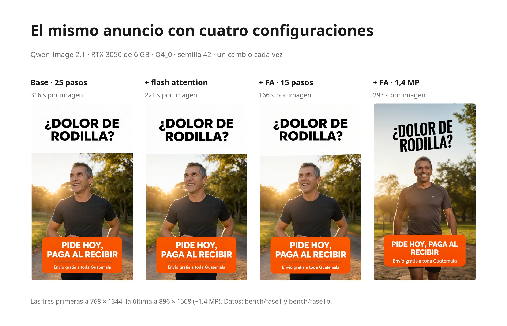
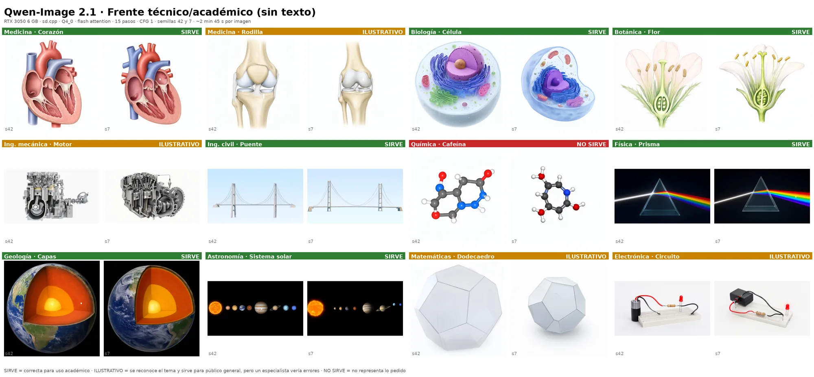

# Qwen-Image 2.1 en una GPU de 6 GB

Receta medida para ejecutar [Qwen-Image 2.1](https://huggingface.co/Qwen/Qwen-Image-2.1) en local en una **RTX 3050 con 6 GB de VRAM y 16 GB de RAM**, con [stable-diffusion.cpp](https://github.com/leejet/stable-diffusion.cpp). Sin ComfyUI y sin entorno de Python: un binario compilado y tres ficheros de modelo.

> [!TIP]
> **¿Necesitas velocidad?** La [receta de Qwen-Image 2.1 Turbo](../Qwen-Image-2.1-Turbo/README.es.md) tarda aproximadamente la mitad, a cambio de algo menos de preferencia en una cata a ciegas.

Todos los números de esta página se midieron en esa máquina. Los scripts que los generaron están en [`scripts/`](scripts/) y los resultados en bruto, un CSV por ronda, en [`bench/`](bench/).

[English version](README.md)


*La receta, semilla 42, sin elegir las mejores. Arriba: foto de producto, retrato y anuncio con texto en español. Abajo: concept art e ilustración anime.*

> [!IMPORTANT]
> **Los pesos del modelo solo se pueden usar con fines no comerciales.** La [Qwen Research License](https://huggingface.co/Qwen/Qwen-Image-2.1/blob/main/LICENSE) (sección 2) permite investigación y evaluación. El uso comercial, incluidos anuncios o fotos de producto para un negocio, requiere una licencia aparte de Qwen (`model-business@notice.qwencloud.com`). Esta guía explica cómo ejecutar el modelo, no qué puedes hacer con lo que genera.

## La receta

```bash
sd-cli \
  --diffusion-model qwen_image_2.1-Q4_0.gguf \
  --vae qwen_image_2.1_vae_bf16.safetensors \
  --llm Qwen3VL-8B-Instruct-Q4_K_M.gguf \
  --offload-to-cpu --diffusion-fa \
  --vae-tiling \
  --cfg-scale 1 --sampling-method euler --steps 25 \
  -W 1184 -H 1184 \
  -p "tu prompt" -o salida.png
```

| | |
|---|---|
| Para qué | Imágenes finales y cualquier cosa con texto |
| Modelo de difusión | Q4_0 |
| Codificador de texto | Q4_K_M |
| Pasos | 25 |
| Cuadrada | 1184 × 1184 |
| Vertical 9:16 | 896 × 1568 |
| Horizontal 16:9 | 1568 × 896 |
| Tiempo por imagen | **~4 min 33 s** (media 272,8 s, rango 271,9-274,2) |
| RAM máxima del sistema | 9,4 GB |

Usa flash attention y CFG 1. El tiempo es de reloj e incluye toda la ejecución: carga, codificación del texto, muestreo y decodificación del VAE. Las medidas tienen que ser múltiplos de 32.

## Instalación

### 1. Compilar stable-diffusion.cpp con CUDA

Usa [`0a9340c`](https://github.com/leejet/stable-diffusion.cpp/commit/0a9340c5) (2026-09-25) o posterior. Arregla las manchas blancas que se describen en [Problemas resueltos](#problemas-resueltos). La ronda final se midió con `f89d9b1` (2026-10-09).

```bash
git clone --recursive https://github.com/leejet/stable-diffusion.cpp
cd stable-diffusion.cpp
cmake -B build -G Ninja -DSD_CUDA=ON -DCMAKE_CUDA_ARCHITECTURES=86 -DCMAKE_BUILD_TYPE=Release
cmake --build build -j
# binarios: build/bin/sd-cli y build/bin/sd-server
```

`86` es la arquitectura de la serie RTX 30. Usa `89` para las RTX 40, o quita la opción para que CMake la detecte.

### 2. Descargar los ficheros del modelo

| Pieza | Fichero | Tamaño | SHA-256 |
|---|---|---|---|
| Modelo de difusión | [`qwen_image_2.1-Q4_0.gguf`](https://huggingface.co/leejet/Qwen-Image-2.1-GGUF/blob/main/qwen_image_2.1-Q4_0.gguf) (leejet) | 4,2 GB | `8d992dc9…cf29e9147` |
| Codificador de texto | [`Qwen3VL-8B-Instruct-Q4_K_M.gguf`](https://huggingface.co/Qwen/Qwen3-VL-8B-Instruct-GGUF/blob/main/Qwen3VL-8B-Instruct-Q4_K_M.gguf) (Qwen) | 5,0 GB | `67d1659b…0e9e2` |
| VAE | [`qwen_image_2.1_vae_bf16.safetensors`](https://huggingface.co/Comfy-Org/Qwen-Image-2.1/blob/main/vae/qwen_image_2.1_vae_bf16.safetensors) (Comfy-Org) | 0,68 GB | `bb21f747…e4876b7c9` |

Los hashes completos están en [`SHA256SUMS`](SHA256SUMS). El VAE es exclusivo de la 2.1: los de Qwen-Image 1 y Wan 2.2 no sirven.

### 3. Liberar la GPU

La receta usa la tarjeta entera. Cierra cualquier otro programa que ocupe VRAM (un servidor de LLM, Whisper) antes de generar, o la ejecución fallará por falta de memoria.

## Por qué estos ajustes

Estos resultados son de la primera ronda, con sd.cpp `c92d73c` (2026-09-22) y `c678dfe`. Desde entonces sd.cpp corrigió el calendario de ruido de Qwen-Image 2.1 ([#2048](https://github.com/leejet/stable-diffusion.cpp/pull/2048)), así que la misma semilla da una imagen ligeramente distinta. En nuestras comprobaciones, la velocidad y la memoria no cambiaron; los números de calidad se volvieron a medir en la ronda final (sección siguiente). Datos en bruto: [`bench/fase1/`](bench/fase1/), [`bench/fase1b/`](bench/fase1b/) y [`bench/fase2/`](bench/fase2/).

Medido con el mismo prompt de anuncio a 768 × 1344, semilla 42, cambiando una sola opción cada vez:

<picture>
  <source media="(prefers-color-scheme: dark)" srcset="assets/speed-dark.es.webp">
  
</picture>

| Cambio | Tiempo | s/paso | Resultado |
|---|---|---|---|
| Base (Q4_0, 25 pasos, CFG 1) | 316 s | 10,5 | — |
| **+ `--diffusion-fa`** | **221 s** | **6,8** | **−30 % en total, −35 % de muestreo**, visualmente idéntica |
| + FA, 20 pasos | 193 s | 7,0 | Casi igual que con 25 pasos en este prompt |
| + FA, 15 pasos | 166 s | 7,5 | Sigue muy parecida |
| Q4_K en vez de Q4_0 | 327 s | 11,0 | Una imagen distinta, no mejor |
| Q5_0 en vez de Q4_0 | 333 s | 11,2 | Igual, y 0,8 GB más de RAM |
| + FA, 1,4 MP (896 × 1568) | 293 s | 9,5 | La única que escribió bien "Envío" |
| 2,4 MP (1152 × 2048) sin FA | — | — | **Sin memoria** (pedía 11,6 GB de VRAM) |
| + FA, 2,4 MP | 502 s | 17,1 | Cabe, pero ver más abajo |

- **Flash attention es la mayor mejora.** No viene activada por defecto. Además, es lo que permite que 2,4 MP quepa en 6 GB.
- **CFG 1, no 6.** El ejemplo de sd.cpp usa `--cfg-scale 6.0`; la plantilla oficial de ComfyUI usa 1. Con un CFG mayor que 1, cada paso se calcula dos veces, así que CFG 1 va más o menos el doble de rápido. En nuestras pruebas también respetó mejor el estilo pedido (con CFG 6 ignoró "soft pastel colors").
- **La resolución importa más que los pasos.** A 1024 × 576 las imágenes salían lavadas; a ~1 MP, no. A ~1 MP, 15, 20 y 25 pasos se veían casi iguales.
- **Q4_K y Q5_0 no mejoraron nada** frente a Q4_0.
- **1,4 MP fue mejor que 2,4 MP en texto en aquella ronda.**

En aquella ronda comparamos tres candidatas (borrador a 15 pasos y ~1 MP, la receta por defecto y la máxima a ~2,4 MP). La receta máxima tardó 8 min 25 s y salió peor que la receta por defecto en todas las medidas, así que más píxeles no compensan con Q4_0. El borrador (15 pasos, 2 min 45 s) ya no se recomienda: si quieres velocidad, usa la [receta Turbo](../Qwen-Image-2.1-Turbo/README.es.md), que es más rápida y mejor.


*El texto pequeño en la primera ronda: solo la receta por defecto escribió "Envío" con tilde en las tres semillas.*

## Resultados de calidad

Medidos en la ronda final, con sd.cpp `f89d9b1`: 6 prompts × 3 semillas, 18 imágenes con esta receta. La ejecución incluyó también las dos variantes del Turbo; sus datos y la tabla de las tres recetas están en la [receta Turbo](../Qwen-Image-2.1-Turbo/README.es.md#comparativa-con-la-receta-normal). Datos en bruto: [`bench/final/`](../Qwen-Image-2.1-Turbo/bench/final/); votos y clave: [`bench/final/ciego/`](../Qwen-Image-2.1-Turbo/bench/final/ciego/).

- **Preferencia a ciegas: 9 de 18 comparaciones** contra las dos variantes del Turbo (Rápida y Poca RAM). Las imágenes se mostraron al mismo tamaño y en orden aleatorio, y votó una sola persona. Esta receta ganó las 3 comparaciones de producto y las 3 de ciudad. Por azar sacaría unas 5 de las 18. La ventaja es una señal clara, pero no una prueba, porque hubo un solo votante.
- **Texto: 6 de 9 imágenes perfectas.** Las 9 imágenes con texto son el anuncio, el producto y la ilustración médica (3 semillas cada uno). Fallos: un anuncio ("Envio" sin tilde) y dos imágenes médicas (una etiqueta "Tibia" repetida y "Tibla"). El texto se revisó letra por letra, a ojo, no con OCR. La ilustración médica, con muchas etiquetas pequeñas, es el caso más difícil para todas las recetas.
- **Manchas blancas: 0 de 18 imágenes.**

## Para qué sirve

Prompts probados: fotos de producto, retratos, anuncios con texto en español, concept art, ilustración anime y escenas de ciudad. El texto es el punto fuerte del modelo en anuncios y etiquetas de producto, tildes incluidas, pero las listas largas de etiquetas pequeñas (la ilustración médica) siguen fallando.

**Imágenes técnicas y académicas.** Probamos 12 temas de distintas disciplinas, sin texto en la imagen, 2 semillas cada uno, con 15 pasos (primera ronda). Datos en bruto: [`bench/tecnico/`](bench/tecnico/).

<picture>
  <source media="(prefers-color-scheme: dark)" srcset="assets/technical-dark.es.webp">
  
</picture>

- **Sirven (7):** corazón, célula, flor, puente colgante, prisma, capas de la Tierra y sistema solar. Las estructuras grandes y conocidas salen bien.
- **Ilustrativas (4):** rodilla (la rótula está mal colocada), motor, dodecaedro y circuito. Se reconocen y valen para público general, pero un especialista vería errores.
- **No sirve (1):** cafeína. La molécula no era cafeína en ninguna de las dos semillas.

El modelo Turbo salió mejor en la misma prueba (8 / 3 / 1); ver la [receta Turbo](../Qwen-Image-2.1-Turbo/README.es.md#para-qué-sirve).

En resumen: sirve para figuras de libro de texto de estructuras grandes y conocidas. No es fiable cuando los detalles tienen que ser exactos: moléculas concretas, piezas mecánicas precisas o la relación espacial entre partes. **Genera sin etiquetas y ponlas tú:** cuando se le piden, el modelo las escribe bien pero las coloca apuntando a la parte equivocada.

## Problemas resueltos

**Manchas blancas: arregladas en sd.cpp [`0a9340c`](https://github.com/leejet/stable-diffusion.cpp/commit/0a9340c5) ([#2054](https://github.com/leejet/stable-diffusion.cpp/pull/2054)).** Con versiones anteriores, algunas imágenes salían con un rectángulo de blanco puro, de bordes duros y 12-16 px de ancho:


- **Causa:** desbordamiento en FP16 en las convoluciones del VAE de Qwen-Image 2.1. El arreglo reduce la escala de sus entradas y la restaura después.
- **Verificado:** regeneramos 3 imágenes que tenían mancha, con las mismas semillas y ajustes, en `3f8527a`. Las 3 salieron limpias y a la misma velocidad. Basta con actualizar; no hace falta ninguna opción. En la ronda final, 0 de 18 imágenes con esta receta la tuvieron.
- Afectó a 12 de las 54 imágenes de la primera comparación, siempre alineadas a la cuadrícula de 16 px del modelo.
- **Una corrección:** una versión anterior de esta página decía que se había descartado la precisión del VAE en GPU, porque decodificar en CPU daba la misma mancha. Esa conclusión era errónea: el desbordamiento ocurre también en las convoluciones FP16 de ese camino, así que la prueba no aislaba lo que creíamos.

Gracias a leejet por el arreglo y por contestar nuestro aviso en Hugging Face.

## Otras cosas que conviene saber

- **Mantén `--vae-tiling`.** Decodificar una imagen de 1 MP de una vez necesita más de 6 GB, y sd.cpp acaba recurriendo a los trozos igualmente. Los trozos de 256 px por defecto funcionan bien. Desde [`19bbbca`](https://github.com/leejet/stable-diffusion.cpp/commit/19bbbca1), `--vae-tile-size` se mide en píxeles de la imagen, no en celdas del latente: si copiaste `--vae-tile-size 24x24` de una versión anterior de esta página, quítalo. **Nunca decodifiques en CPU sin trozos:** a 1024² agotó los 16 GB de RAM y el kernel mató el proceso.
- **La primera imagen tras reiniciar tarda ~1 minuto más** si los pesos están en un disco duro mecánico, porque hay que leer ~10 GB. Después quedan en la caché del sistema y cargan en ~3 s.
- **No midas mientras descargas.** Las descargas al mismo disco expulsan los pesos de la caché; en nuestras pruebas la carga pasó de 3 s a 36 s.
- **La columna de VRAM siempre marca ~5,1-5,2 GB.** sd.cpp ocupa toda la memoria libre y trae el resto desde la RAM. Es lo que usa, no lo que necesita; la VRAM mínima no se ha medido.
- **Los PNG de salida son RGBA** aunque la imagen sea opaca, porque Qwen-Image 2.1 admite transparencia.

## Reproducir las medidas

```bash
scripts/bench.sh <ronda> <nombre> <modelo> <pasos> <prompt_id> [W H] [-- opciones extra de sd-cli]
scripts/fase1.sh      # velocidad y memoria, una variable cada vez (primera ronda)
scripts/fase1b.sh     # combinaciones con flash attention (primera ronda)
scripts/fase2.sh      # 3 recetas iniciales × 6 prompts × 3 semillas (primera ronda, ~5 h, reanudable)
scripts/tecnico.sh    # 12 temas técnicos × 2 semillas (primera ronda)
```

`bench.sh` acepta el sufijo de un fichero de modelo o la ruta completa de un `.gguf`. La variable de entorno `LLM` elige el codificador de texto; por defecto es el Q4_K_M. El script de la ronda final (`final.sh`) está en la [carpeta del Turbo](../Qwen-Image-2.1-Turbo/scripts/).

Los prompts están en [`prompts/`](prompts/). Cada ejecución añade una fila a un `resultados.csv` con el tiempo, la RAM y la VRAM máximas y las opciones exactas; las imágenes y los logs se guardan al lado, pero no se incluyen en este repo. Datos por ronda: [`bench/fase1/`](bench/fase1/), [`bench/fase1b/`](bench/fase1b/), [`bench/fase2/`](bench/fase2/) (con la primera prueba a ciegas en [`bench/fase2/ciego/`](bench/fase2/ciego/)) y [`bench/tecnico/`](bench/tecnico/). Los scripts usan las rutas de la máquina de pruebas; cambia `D` y `SD` al principio de `bench.sh`.

## Máquina de pruebas

| | |
|---|---|
| GPU | NVIDIA RTX 3050 6 GB (5,8 GiB utilizables), driver 595.71.05, CUDA 13.0 |
| CPU / RAM | 6 núcleos, 16 GB |
| Almacenamiento | Pesos en un disco duro de 7200 rpm |
| Sistema | Ubuntu 24.04 |
| sd.cpp | Ronda final: `f89d9b1` (2026-10-09). Primera ronda: `c92d73c` (fase 2) y `c678dfe` (fase 1 y prueba técnica; una imagen comparada entre las dos salió idéntica bit a bit). Arreglo de las manchas verificado en `3f8527a` |

## Licencia

Los scripts de esta carpeta se publican con la [licencia MIT](../LICENSE). Los pesos del modelo no se incluyen y mantienen sus propias licencias: Qwen-Image 2.1 y el VAE, la [Qwen Research License](https://huggingface.co/Qwen/Qwen-Image-2.1/blob/main/LICENSE) (no comercial); el codificador de texto Qwen3-VL, Apache 2.0.
