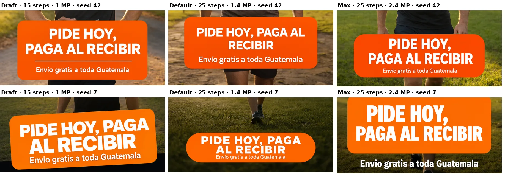
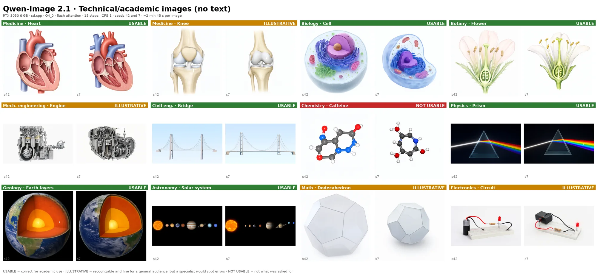
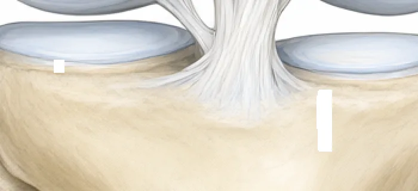

# Qwen-Image 2.1 on a 6 GB GPU

A measured recipe for running [Qwen-Image 2.1](https://huggingface.co/Qwen/Qwen-Image-2.1) locally on an **RTX 3050 with 6 GB of VRAM and 16 GB of RAM**, using [stable-diffusion.cpp](https://github.com/leejet/stable-diffusion.cpp). No ComfyUI, no Python stack: one compiled binary and three model files.

> [!TIP]
> **Need speed?** The [Qwen-Image 2.1 Turbo recipe](../Qwen-Image-2.1-Turbo/README.md) takes about half the time, at the cost of somewhat lower preference in a blind test.

Every number on this page was measured on that machine. The scripts that produced them are in [`scripts/`](scripts/) and the raw results, one CSV per round, are in [`bench/`](bench/).

[Versión en español](README.es.md)


*The recipe, seed 42, no cherry-picking. Top: product shot, portrait, ad with Spanish text. Bottom: concept art, anime illustration.*

> [!IMPORTANT]
> **The model weights are licensed for non-commercial use only.** The [Qwen Research License](https://huggingface.co/Qwen/Qwen-Image-2.1/blob/main/LICENSE) (section 2) allows research and evaluation. Commercial use, including ads or product photos for a business, needs a separate license from Qwen (`model-business@notice.qwencloud.com`). This guide covers running the model, not what you are allowed to do with its output.

## The recipe

```bash
sd-cli \
  --diffusion-model qwen_image_2.1-Q4_0.gguf \
  --vae qwen_image_2.1_vae_bf16.safetensors \
  --llm Qwen3VL-8B-Instruct-Q4_K_M.gguf \
  --offload-to-cpu --diffusion-fa \
  --vae-tiling \
  --cfg-scale 1 --sampling-method euler --steps 25 \
  -W 1184 -H 1184 \
  -p "your prompt" -o out.png
```

| | |
|---|---|
| Use it for | Final images, anything with text |
| Diffusion model | Q4_0 |
| Text encoder | Q4_K_M |
| Steps | 25 |
| Square | 1184 × 1184 |
| Portrait 9:16 | 896 × 1568 |
| Landscape 16:9 | 1568 × 896 |
| Time per image | **~4 min 33 s** (mean 272.8 s, range 271.9–274.2) |
| Peak system RAM | 9.4 GB |

It uses flash attention and CFG 1. The time is wall clock for the whole run: loading, text encoding, sampling and VAE decoding. Sizes must be multiples of 32.

## Setup

### 1. Build stable-diffusion.cpp with CUDA

Use [`0a9340c`](https://github.com/leejet/stable-diffusion.cpp/commit/0a9340c5) (2026-09-25) or later. It fixes the white patches described under [Resolved issues](#resolved-issues). The final round was measured on `f89d9b1` (2026-10-09).

```bash
git clone --recursive https://github.com/leejet/stable-diffusion.cpp
cd stable-diffusion.cpp
cmake -B build -G Ninja -DSD_CUDA=ON -DCMAKE_CUDA_ARCHITECTURES=86 -DCMAKE_BUILD_TYPE=Release
cmake --build build -j
# binaries: build/bin/sd-cli and build/bin/sd-server
```

`86` is the RTX 30-series architecture. Use `89` for RTX 40 or drop the flag to let CMake detect it.

### 2. Download the model files

| Part | File | Size | SHA-256 |
|---|---|---|---|
| Diffusion model | [`qwen_image_2.1-Q4_0.gguf`](https://huggingface.co/leejet/Qwen-Image-2.1-GGUF/blob/main/qwen_image_2.1-Q4_0.gguf) (leejet) | 4.2 GB | `8d992dc9…cf29e9147` |
| Text encoder | [`Qwen3VL-8B-Instruct-Q4_K_M.gguf`](https://huggingface.co/Qwen/Qwen3-VL-8B-Instruct-GGUF/blob/main/Qwen3VL-8B-Instruct-Q4_K_M.gguf) (Qwen) | 5.0 GB | `67d1659b…0e9e2` |
| VAE | [`qwen_image_2.1_vae_bf16.safetensors`](https://huggingface.co/Comfy-Org/Qwen-Image-2.1/blob/main/vae/qwen_image_2.1_vae_bf16.safetensors) (Comfy-Org) | 0.68 GB | `bb21f747…e4876b7c9` |

Full hashes are in [`SHA256SUMS`](SHA256SUMS). The VAE is specific to 2.1: the Qwen-Image 1 and Wan 2.2 VAEs do not work.

### 3. Free the GPU

The recipe uses the whole card. Close anything else holding VRAM (an LLM server, Whisper) before generating, or the run fails with an out-of-memory error.

## Why these settings

These results come from the first round, on sd.cpp `c92d73c` (2026-09-22) and `c678dfe`. Since then sd.cpp corrected Qwen-Image 2.1's noise schedule ([#2048](https://github.com/leejet/stable-diffusion.cpp/pull/2048)), so the same seed gives a slightly different image. Speed and memory did not change in our checks; the quality numbers were re-measured in the final round (next section). Raw data: [`bench/fase1/`](bench/fase1/), [`bench/fase1b/`](bench/fase1b/) and [`bench/fase2/`](bench/fase2/).

Measured with the same ad prompt at 768 × 1344, seed 42, one flag changed at a time:


| Change | Time | s/step | Result |
|---|---|---|---|
| Baseline (Q4_0, 25 steps, CFG 1) | 316 s | 10.5 | — |
| **+ `--diffusion-fa`** | **221 s** | **6.8** | **−30 % total, −35 % sampling**, visually identical |
| + FA, 20 steps | 193 s | 7.0 | Near-identical to 25 steps on this prompt |
| + FA, 15 steps | 166 s | 7.5 | Still close |
| Q4_K instead of Q4_0 | 327 s | 11.0 | A different image, not a better one |
| Q5_0 instead of Q4_0 | 333 s | 11.2 | Same, and +0.8 GB of RAM |
| + FA, 1.4 MP (896 × 1568) | 293 s | 9.5 | The only one that spelled "Envío" right |
| 2.4 MP (1152 × 2048) without FA | — | — | **Out of memory** (asked for 11.6 GB of VRAM) |
| + FA, 2.4 MP | 502 s | 17.1 | Fits, but see below |

- **Flash attention is the single biggest win.** It is not on by default. It also makes 2.4 MP fit in 6 GB.
- **CFG 1, not 6.** The sd.cpp example uses `--cfg-scale 6.0`; the official ComfyUI template uses 1. With CFG above 1 every step runs twice, so CFG 1 is about twice as fast. In our tests it also followed the prompt's style better (CFG 6 ignored "soft pastel colors").
- **Resolution matters more than steps.** At 1024 × 576 images came out washed out; at ~1 MP they did not. At ~1 MP, 15, 20 and 25 steps looked nearly the same.
- **Q4_K and Q5_0 gave no improvement** over Q4_0.
- **1.4 MP beat 2.4 MP on text in that round.**

In that round we compared three candidates (draft at 15 steps and ~1 MP, default, and max at ~2.4 MP). The max recipe took 8 min 25 s and did worse than the default on every measure, so more pixels are not worth it at Q4_0. The draft recipe (15 steps, 2 min 45 s) is no longer recommended: if you want speed, use the [Turbo recipe](../Qwen-Image-2.1-Turbo/README.md), which is faster and better.


*Small text in the first round: only the default recipe spelled "Envío" with its accent in all three seeds.*

## Quality results

Measured in the final round, on sd.cpp `f89d9b1`: 6 prompts × 3 seeds, 18 images with this recipe. The run also included the two Turbo variants; their data and the three-way table are in the [Turbo recipe](../Qwen-Image-2.1-Turbo/README.md#comparison-with-the-regular-recipe). Raw data: [`bench/final/`](../Qwen-Image-2.1-Turbo/bench/final/); votes and answer key: [`bench/final/ciego/`](../Qwen-Image-2.1-Turbo/bench/final/ciego/).

- **Blind preference: 9 of 18 comparisons** against the two Turbo variants (Fast and Low RAM). Images were shown at the same size in random order, and one person voted. This recipe won all 3 product comparisons and all 3 city comparisons. By chance it would get about 5 of 18. The lead is a clear signal but not proof, because there was a single voter.
- **Text: 6 of 9 images perfect.** The 9 text images are the ad, the product shot and the medical illustration (3 seeds each). Failures: one ad ("Envio" without the accent) and two medical images (a repeated "Tibia" label, and "Tibla"). Text was checked letter by letter, by eye, not with OCR. The medical illustration, with many small labels, is the hardest case for every recipe.
- **White patches: 0 of 18 images.**

## What it is good for

Tested prompts: product shots, portraits, ads with Spanish text, concept art, anime illustration and city scenes. Text rendering is the model's strong point on ads and product labels, accents included, but long lists of small labels (the medical illustration) still fail.

**Technical and academic images.** We tested 12 subjects across disciplines, without text in the image, 2 seeds each, at 15 steps (first round). Raw data: [`bench/tecnico/`](bench/tecnico/).



- **Usable (7):** heart, cell, flower, suspension bridge, prism, Earth's layers, solar system. Large, well-known structures come out right.
- **Illustrative (4):** knee (the kneecap sits in the wrong place), engine, dodecahedron, circuit. Recognizable, fine for a general audience; a specialist would spot errors.
- **Not usable (1):** caffeine. The molecule was not caffeine in either seed.

The Turbo model did better on the same test (8 / 3 / 1); see the [Turbo recipe](../Qwen-Image-2.1-Turbo/README.md#what-it-is-good-for).

In short: good for textbook-style figures of big, familiar structures. Not reliable where details must be exact (specific molecules, precise mechanical parts, spatial relations between parts). **Generate without labels and add them yourself:** when asked for labels, the model spells them well but points them at the wrong part.

## Resolved issues

**White patches: fixed in sd.cpp [`0a9340c`](https://github.com/leejet/stable-diffusion.cpp/commit/0a9340c5) ([#2054](https://github.com/leejet/stable-diffusion.cpp/pull/2054)).** With earlier versions, some images got a hard-edged rectangle of pure white, 12–16 px wide:



- **Cause:** FP16 overflow in the Qwen-Image 2.1 VAE's convolutions. The fix scales their inputs down and restores the outputs afterwards.
- **Verified:** we regenerated 3 images that had patches, with the same seeds and settings, on `3f8527a`. All 3 came out clean, at the same speed. Upgrading is the whole fix; no flag is needed. In the final round, 0 of 18 images with this recipe had one.
- It affected 12 of the 54 images of the first comparison, always aligned to the model's 16 px grid.
- **A correction:** an earlier version of this page said GPU precision in the VAE had been ruled out, because decoding on the CPU gave the same patch. That conclusion was wrong: the overflow happens in FP16 convolutions on that path too, so the test did not isolate what we thought it did.

Thanks to leejet for the fix and for answering our report on Hugging Face.

## Other things to know

- **Keep `--vae-tiling`.** Decoding a 1 MP image in one piece needs more than 6 GB and sd.cpp falls back to tiling anyway. The default 256 px tiles are fine. Since [`19bbbca`](https://github.com/leejet/stable-diffusion.cpp/commit/19bbbca1), `--vae-tile-size` is measured in image pixels, not latent cells: if you copied `--vae-tile-size 24x24` from an older version of this page, remove it. **Never decode on the CPU without tiling:** at 1024² it used all 16 GB of RAM and the kernel killed the process.
- **The first image after a reboot is ~1 minute slower** if the weights live on a hard disk: ~10 GB have to be read. After that they stay in the OS page cache and load in ~3 s.
- **Don't benchmark while downloading.** Downloads to the same disk evict the cached weights; load time went from 3 s to 36 s in our tests.
- **The VRAM column always shows ~5.1–5.2 GB.** sd.cpp fills whatever is free and streams the rest from RAM. It is what it uses, not what it needs; the minimum VRAM has not been measured.
- **Output PNGs are RGBA** even for opaque images, because Qwen-Image 2.1 supports transparency.

## Reproduce the measurements

```bash
scripts/bench.sh <round> <name> <model> <steps> <prompt_id> [W H] [-- extra sd-cli args]
scripts/fase1.sh      # speed and memory, one variable at a time (first round)
scripts/fase1b.sh     # flash-attention combinations (first round)
scripts/fase2.sh      # 3 early recipes × 6 prompts × 3 seeds (first round, ~5 h, resumable)
scripts/tecnico.sh    # 12 technical subjects × 2 seeds (first round)
```

`bench.sh` takes either the suffix of a model file or the full path to a `.gguf`. The `LLM` environment variable selects the text encoder; by default it is the Q4_K_M. The final round's script (`final.sh`) is in the [Turbo folder](../Qwen-Image-2.1-Turbo/scripts/).

Prompts are in [`prompts/`](prompts/). Every run appends one row to a `resultados.csv` with the time, the peak RAM and VRAM and the exact flags; the images and logs are written next to it but are not included in this repo. Data by round: [`bench/fase1/`](bench/fase1/), [`bench/fase1b/`](bench/fase1b/), [`bench/fase2/`](bench/fase2/) (with the first blind test in [`bench/fase2/ciego/`](bench/fase2/ciego/)) and [`bench/tecnico/`](bench/tecnico/). The scripts assume the model paths of the test machine; edit `D` and `SD` at the top of `bench.sh`.

## Test machine

| | |
|---|---|
| GPU | NVIDIA RTX 3050 6 GB (5.8 GiB usable), driver 595.71.05, CUDA 13.0 |
| CPU / RAM | 6 cores, 16 GB |
| Storage | Weights on a 7200 rpm hard disk |
| OS | Ubuntu 24.04 |
| sd.cpp | Final round: `f89d9b1` (2026-10-09). First round: `c92d73c` (phase 2) and `c678dfe` (phase 1 and the technical test; one image compared across both was bit-identical). White-patch fix verified on `3f8527a` |

## License

The scripts in this folder are released under the [MIT license](../LICENSE). The model weights are not included and keep their own licenses: Qwen-Image 2.1 and the VAE under the [Qwen Research License](https://huggingface.co/Qwen/Qwen-Image-2.1/blob/main/LICENSE) (non-commercial); the Qwen3-VL text encoder under Apache 2.0.
